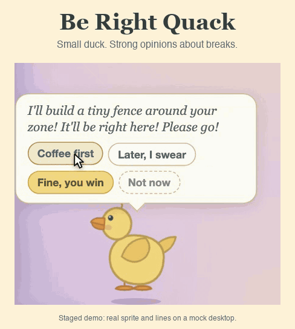

# Be Right Quack 🦆

> Reporting for temporary duty.

A tiny duck with a TEMP badge and very strong opinions about taking a break. Wake it on your Mac to time a focus sprint, get a gentle nudge, or let it cover your desk for five minutes. It might even file a report when you get back. The stapler was fine, by the way.



Staged demo with the real duck sprite and lines on a mock desktop.

The desktop duck runs on its own. You do not need the Copilot app, a canvas, or an AI agent. Optional **Little intermissions** Copilot canvas integration adds three companions: a canvas version of the duck, **Fern the frog** with tiny expeditions, and **Brain Bakery** with break keepsakes. Only the duck can float on your desktop; Fern and the bakery stay inside the canvas.

## Wake the duck

The floating duck needs **macOS 13 or later**, **Swift 5.9 or later**, and **Node.js 18 or later** on your PATH. Check with `swiftc --version`; if the Apple command line tools are missing, run `xcode-select --install`. There is no `npm install` step.

Clone this repo and start the duck directly:

```sh
git clone https://github.com/kangarruu/be-right-quack.git
cd be-right-quack
node little-intermissions/duck-cli.mjs wake
```

The first wake compiles the duck locally and can take a minute. The duck runs as a separate desktop process after the command returns. Right-click it for settings or to send it home. Keep the cloned folder for future launches and updates. Each source version has its own cached executable and matching animation files; changing checkouts cannot reuse another version's executable based on file timestamps.

## A duck in your terminal

No global `duck` command is installed. From the repo root, use:

```sh
duck_cli="little-intermissions/duck-cli.mjs"
node "$duck_cli" help
node "$duck_cli" wake
node "$duck_cli" sprint 25
node "$duck_cli" status
node "$duck_cli" home
```

Focus sprints accept 1 to 180 whole minutes and default to 25. Use `sprint stop` to cancel or `sprint extend` to add five minutes. Use `nudges off` (or `30`, `50`, `75`, or `90`) and `playfulness calm` (or `lively`) to change saved settings. `snooze` pauses unsolicited quips, wandering, and welcomes for an hour or until the duck quits, without canceling a sprint or its end prompt.

For less serious work, try `cute`, `flip`, `cover`, `convince`, `nudge`, or `say "The stapler is secure."` You can also choose **Flip** from the right-click menu. Each `flip` plays one destructive cartoon gag; it does not touch your real desk or windows. The duck uses text bubbles, not audio. Some requests are queued and can be skipped if they don't fit what the duck is doing; `flip` is quiet during focus sprints. The sprite and debate choices use the mouse; VoiceOver operation has not been verified.

## Accessories

Right-click the duck and open **Accessories**. Dividers separate hats and caps, crowns and costumes, novelty hats, and face and neck accessories. Each choice replaces the last.

Choose **Nude** to take everything off; that's how the duck starts every time.

## Optional Copilot canvas integration

The canvas needs a GitHub Copilot app build that supports canvas extensions. The canvas itself does not need Swift; waking the desktop duck from it still needs the desktop prerequisites above.

To make the three canvas companions available in Copilot, copy the [extension folder](little-intermissions/) into your personal Copilot extensions directory. From the repo root:

```sh
extensions="${COPILOT_HOME:-$HOME/.copilot}/extensions"
mkdir -p "$extensions"
if [ -e "$extensions/little-intermissions" ] || [ -L "$extensions/little-intermissions" ]; then
  printf '%s\n' 'Little intermissions is already installed. Back it up before replacing it.'
else
  cp -R little-intermissions "$extensions/"
fi
```

Reload extensions in Copilot, then ask **"Open Little intermissions."** Select **Duck takes over** and choose **Wake the duck**. Installing or reloading the extension does not start the desktop duck. Copying is only needed for Copilot to find the canvas extension, not for the standalone CLI.

To use the CLI from that installed copy instead of the clone, set `duck_cli="${COPILOT_HOME:-$HOME/.copilot}/extensions/little-intermissions/duck-cli.mjs"`.

## What stays on your Mac

- **Canvas:** Copilot saves your note, companion preferences, break times, report cursors, and up to 24 keepsakes in `little-intermissions.json` in the current conversation's workspace. The native duck does not read that file. Keep it out of Git if it contains private notes.
- **Desktop:** `${COPILOT_HOME:-$HOME/.copilot}/state/little-intermissions/` contains cached executable/animation bundles under `builds/`, settings, sprint state, process records, per-instance control credentials, and logs. This defaults to `~/.copilot/state/little-intermissions/` even if Copilot is not installed. Keep it private. Old bundles remain cached until you remove them with the duck stopped. Logs are not rotated automatically; compiler diagnostics can include local paths.
- **Privacy and limits:** The extension makes no external network requests and sends no analytics. The canvas uses a token-protected, same-origin loopback server. Native control uses private local files and per-instance authentication. Neither isolates the extension from other software running as your user. The duck reads the OS's time since the last input event; it does not record keys, window contents, screenshots, or work activity. There is no login item. The menu briefly takes focus and tries to return it to the previous app. The duck may appear in screen sharing or recordings.

## Update or uninstall

1. Use `node "$duck_cli" home` or right-click and choose **Send duck home**. Wait for the duck to quit. Reloading extensions does not replace a running native duck. If an older duck does not respond to the CLI, use its menu; do not kill a process based on a saved PID.
2. For the standalone CLI, update the clone with `git pull --ff-only`, or remove the cloned folder to uninstall. If you installed the optional canvas integration, move the installed `little-intermissions` folder out of the extensions directory and reload Copilot's extensions. To update that copy, put the new folder in its place before reloading. If you made a terminal shortcut, remove only the link that points to this extension.
3. If you want to delete its saved settings and logs, remove only the extension's state directory after the duck has quit. Canvas notes and keepsakes remain in each conversation's `little-intermissions.json`; remove those separately only if you want to lose them.

For a complete local update of the optional canvas integration, first send the duck home and wait for it to quit. Then run these commands from the updated repo root. This backs up the old installation outside the extensions directory and copies the whole package, including `duck/Duck.swift`, `duck/sprite.html`, `duck/voice.js`, `duck/lines.js`, and the launcher. Do not copy only the executable or only `Duck.swift`.

```sh
copilot_home="${COPILOT_HOME:-$HOME/.copilot}"
extensions="$copilot_home/extensions"
mkdir -p "$extensions"
backup="$(mktemp -d "$copilot_home/little-intermissions-backup.XXXXXX")"
if [ -e "$extensions/little-intermissions" ] || [ -L "$extensions/little-intermissions" ]; then
  mv "$extensions/little-intermissions" "$backup/"
fi
cp -R little-intermissions "$extensions/"
```

Reload extensions in Copilot. When you are ready to start the updated duck, run `node "$extensions/little-intermissions/duck-cli.mjs" wake`. The first launch of changed source or animation files builds a new matching bundle; it does not reuse the old shared `duck` executable. Choose **Flip** from the right-click menu to play a gag.

## Local checks

Run `cd little-intermissions && node --test *.test.mjs` from the repo root. Tests use temporary state, and the macOS native test compiles a hidden, disposable harness. To type-check against macOS 13 on Apple silicon, run `swiftc -typecheck -swift-version 5 -target arm64-apple-macosx13.0 duck/Duck.swift` from the extension folder (use `x86_64` for Intel).

No license is specified in this repository.
